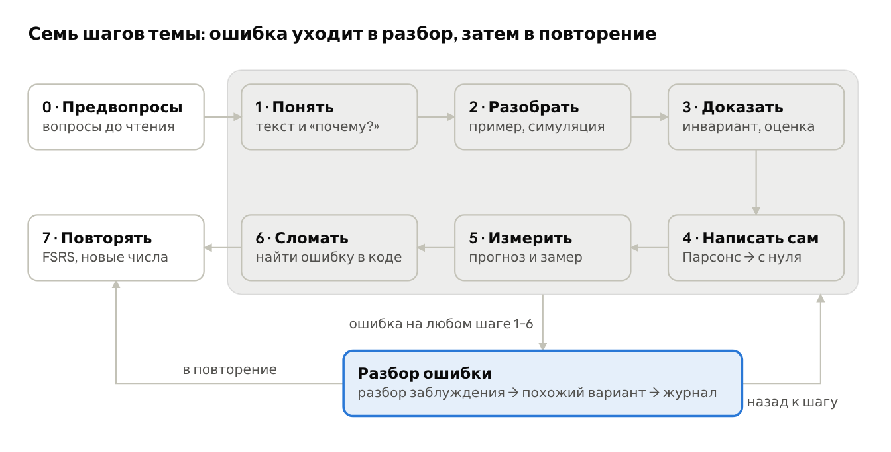
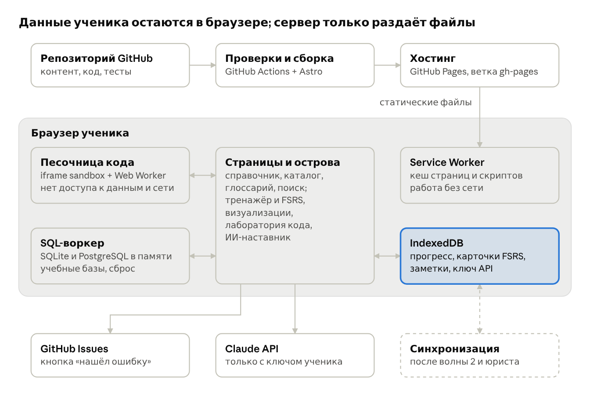
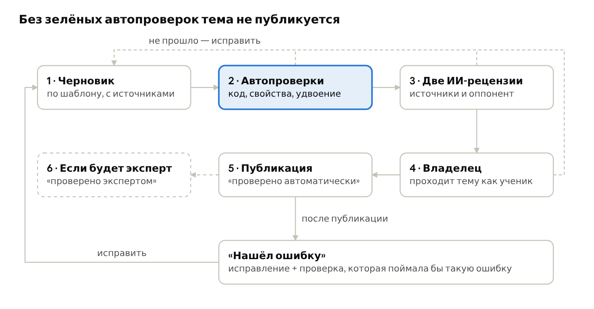
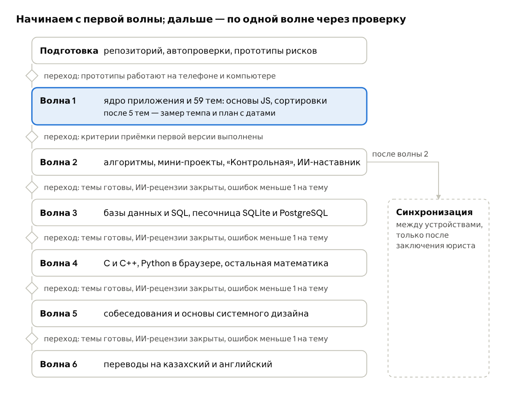

# ТЗ: «Инвариант» — учебное приложение по алгоритмам, структурам данных и базам данных

> Выгрузка документа ТЗ от 23 октября 2026 года. С этого момента основная версия — этот файл: правки вносим через pull request.

## Обзор

Делаем «Инвариант» — бесплатное открытое веб-приложение для глубокого изучения алгоритмов и структур данных, баз данных и SQL, C и C++, Python и математики для информатики. В одном месте: справочник, тренажёры с генераторами заданий, визуализации, запуск кода и интервальное повторение.

Цель — чтобы человек не узнавал правильный ответ среди вариантов, а умел объяснить, доказать, написать код сам, измерить его и помнить это через месяцы. Главный показатель успеха — что человек помнит и умеет через два-три месяца, а не время, проведённое в приложении.

**Для кого.**

- Первый пользователь — автор проекта: учится с нуля и проверяет каждую волну контента на себе.
- Все, кто учится на русском: студенты, самоучки, кандидаты на собеседования. Позже — на казахском и английском.
- Входной уровень — ноль: основы программирования объясняются внутри приложения.

**Сводка принятых решений.**

| Тема | Решение | Почему |
| --- | --- | --- |
| Что это | Веб-приложение (PWA): работает в браузере на компьютере и телефоне, ставится на главный экран, работает без интернета | Одна кодовая база, не нужны магазины приложений |
| Разделы | Алгоритмы и структуры данных; базы данных и SQL; C и C++; Python; математика для информатики; трек подготовки к собеседованиям | Решение владельца |
| Глубина | Три уровня в каждой теме: Фундамент, База, Глубина | Можно начать с нуля и дойти до доказательств и тонкостей |
| Объём | Полный каталог тем фиксируется сразу; контент выходит волнами; ничего не вырезается | Объём большой: первая волна проверяет качество и темп |
| Как учим | Предвопросы и цикл из семи шагов; разбор каждой ошибки; интервальное повторение по алгоритму FSRS | Методы с доказанной пользой (раздел «Принципы обучения») |
| Язык упражнений | JavaScript: код запускается прямо в браузере. C++ и Python — вкладки с тем же алгоритмом, проверенные автоматически. В разделе «Python» свой код запускается через Pyodide (волна 4); запуск C++ в браузере исследуем в волне 4 | Не нужен сервер для запуска кода |
| Аккаунты | Без регистрации. Прогресс хранится в браузере, есть экспорт и импорт в файл. Синхронизация между устройствами — после волны 2 и заключения юриста | Быстрый старт без сервера и без сбора персональных данных |
| Хостинг | Код и сайт на GitHub: сайт на GitHub Pages по адресу вида «логин.github.io/invariant» | Решение владельца; бесплатно для открытого репозитория |
| ИИ-наставник | По желанию, на своём ключе API; ключ хранится только в браузере пользователя | Проект не платит за ИИ и никогда не видит ключи |
| Лицензии | Код — MIT; учебный контент — CC BY-SA 4.0 | Любой может пользоваться, исправлять и развивать |
| Язык интерфейса | Русский; всё готово к переводу на казахский и английский | — |
| Дизайн | Строгий монохром; цвет только в визуализациях; светлая и тёмная темы | Ничто не отвлекает от материала |
| Роли | Claude пишет код и контент; автопроверки и две независимые ИИ-рецензии проверяют контент; владелец тестирует и принимает. Эксперта-человека нет | Ошибки в учебнике недопустимы |
| Не делаем | Очки, серии, рейтинги; ежедневная цель и напоминания; «карта памяти» | Решение владельца: отвлекает от учёбы |

Решения по предложениям и нерешённые вопросы собраны в разделе «Открытые вопросы и что нужно от владельца».

## Путь ученика

Так приложением пользуется человек, который начинает с нуля: первый день, следующий день, месяц занятий и возвращение после перерыва. Всё, что здесь упомянуто, подробно описано в разделах ниже.

**Первый день.**

1. Человек открывает ссылку на компьютере или телефоне. Регистрации нет — сразу видны разделы. Приложение запрашивает у браузера постоянное хранилище, а на iPhone предлагает добавить себя на экран «Домой» и объясняет зачем: иначе Safari может стереть прогресс.
2. Кто программирует впервые, начинает с раздела 0 «Основы JavaScript», остальные — с любого модуля, например с «Сортировок». Любую тему можно открыть и прочитать; её предпосылки видны в шапке.
3. Тема «Сортировка вставками», уровень Фундамент. Сначала два-три предвопроса: ошибаться здесь нормально, ответы не оцениваются. Затем объяснение на примере карт в руке и визуализация, которая перед шагом спрашивает «что произойдёт?».
4. Человек сам сортирует \[7, 3, 5, 1, 4\] нажатиями на элементы; каждый его шаг сверяется с эталонным следом алгоритма.
5. Перед проверкой каждого ответа он отмечает уверенность: «знаю», «сомневаюсь» или «наугад». Ошибка сразу разбирается: правильный ответ, объяснение заблуждения, ссылка на блок справочника и похожий вариант с другими числами.
6. В конце уровня — сборка кода из перемешанных строк и итоговая проверка на новых вариантах. Навыки темы становятся карточками, и планировщик FSRS сам назначает, когда каждая вернётся. Уровень пока «изучается»: освоенным он станет только после отложенной проверки — не раньше чем через день.

**Следующий день.**

- На главной — «Продолжить» (тема и шаг, где человек остановился) и «Повторение».
- В повторении — карточки, срок которых подошёл, вперемешку. Каждая показывает новый вариант с другими числами: запомнить ответ нельзя, можно только понять способ.
- Вчерашние уверенные ошибки проверяются снова, ещё одна проверка — через неделю после ошибки.
- Приходит отложенная проверка по вчерашнему уровню — три вопроса. Если выполнены все условия, уровень становится «освоен».
- Дальше — новый материал: следующий уровень или следующая тема, в пределах дневного лимита (по умолчанию 10 новых навыков и 100 повторений).

**Через месяц.**

- Интервалы растут: то, что держится в памяти, возвращается всё реже, трудное — чаще.
- Похожие темы специально стоят рядом — например, сортировки вставками и выбором, — чтобы человек учился их различать.
- Журнал ошибок показывает частые заблуждения. Если ошибки сходятся к одной предпосылке, приложение предлагает к ней вернуться.
- На уровне База человек пишет код сам, предсказывает и измеряет рост числа операций на n, 2n, 4n…, ищет ошибку в испорченном коде; на уровне Глубина — доказывает корректность и точно считает операции.
- Время от времени он сохраняет копию прогресса в файл: до появления синхронизации это единственная защита от потери данных и способ перенести занятия на другое устройство. Дата последней копии видна в настройках.
- С волны 2 можно подключить ИИ-наставника на своём ключе: «объясни иначе», наводящие подсказки, разбор кода.
- Перед экзаменом или собеседованием — режим «Контрольная» (с волны 2): смешанные задания по выбранным темам с таймером и без подсказок, а в конце — итог по темам и разбор ошибок.

**Возвращение после перерыва.**

- Ничего не «сгорает»: серий, целей и напоминаний нет, вернуться можно в любой момент.
- Накопившиеся повторения не вываливаются разом: сначала идут карточки с наименьшей вероятностью вспомнить, в пределах дневного лимита, остальные — в следующие дни.
- После долгого перерыва — по умолчанию больше 30 дней без занятий — приложение предлагает короткую диагностику по пройденным темам: что сохранилось, а что пройти заново и с какого уровня.
- «Продолжить» ведёт к той теме и тому шагу, где человек остановился.
- Если данные в браузере стёрты — очищен браузер или сменилось устройство, — прогресс восстанавливается из файла копии.

## Принципы обучения

В приложение попадает только то, что по исследованиям улучшает запоминание и понимание. Приятное, но малополезное — перечитывание, выделение маркером, очки — основой учёбы не делаем.

| Принцип | Как это сделано в приложении | На чём основано |
| --- | --- | --- |
| Проверка себя вместо перечитывания | Каждый шаг темы заканчивается вопросами. Где можно — свободный ввод, а не выбор из вариантов. Повторение идёт только через вопросы | [Dunlosky и др., 2013](https://www.psychologicalscience.org/journals/pspi/1529100612453266/): практика тестирования — высокая полезность |
| Распределённое повторение | Планировщик FSRS сам выбирает, что и когда повторить, с растущими интервалами | [Dunlosky и др., 2013](https://www.psychologicalscience.org/journals/pspi/1529100612453266/): высокая полезность; [описание FSRS](https://docs.ankiweb.net/faqs/what-spaced-repetition-algorithm.md) |
| Чередование похожих тем | Новую тему сначала учим блоком, потом перемешиваем с похожими. Есть задания «какой это алгоритм» и пары путаницы | [Brunmair, Richter, 2019](https://www.psychologie.uni-wuerzburg.de/fileadmin/06020400/2019/Brunmair_Richter_in_press__2019_META-ANALYSIS_OF_INTERLEAVED_LEARNING.pdf): средний эффект g = 0,42; сильнее, когда категории похожи друг на друга; на заучивании слов чередование проигрывало |
| Вопросы «почему?» и самообъяснение | После ключевых шагов — поле «почему это верно?», затем эталонное объяснение для сравнения | [Dunlosky и др., 2013](https://www.psychologicalscience.org/journals/pspi/1529100612453266/): умеренная полезность |
| Предвопросы | 2–3 вопроса до начала темы. Ошибка здесь ожидаема и ни на что не влияет | [Richland, Kornell, Kao, 2009](https://learninglab.uchicago.edu/Pre-Testing_files/RichlandKornellKao.pdf): предтест помог даже там, где ответ был неверным; [Kornell, Hays, Bjork, 2009](https://pubmed.ncbi.nlm.nih.gov/19586265/) |
| Отметка уверенности | Перед проверкой ответа — «знаю / сомневаюсь / наугад». Уверенная ошибка разбирается сразу и проверяется снова через день и через неделю | [Butterfield, Metcalfe, 2001](<https://en.wikipedia.org/wiki/Hypercorrection_(psychology)>): уверенные ошибки исправляются лучше; [Butler, Fazio, Marsh, 2011](https://profiles.wustl.edu/en/publications/the-hypercorrection-effect-persists-over-a-week-but-high-confiden/): если правильный ответ забыт, они возвращаются |
| Разобранные примеры с подцелями | Код в разборе разбит на названные шаги: «найти середину», «сузить отрезок» | [Margulieux, Guzdial, Catrambone, 2012](https://en.wikipedia.org/wiki/Subgoal_labeling) |
| Задачи Парсонса | Перед «напиши сам» — собрать программу из перемешанных строк. На телефоне это основной формат практики кода | [Ericson, 2018](https://hg.gatech.edu/node/603172): решаются быстрее, чем написание или исправление кода, при том же приросте знаний |
| Активная работа с визуализацией | Анимацию не просто смотрят: предсказывают следующий шаг, вводят свои данные, выполняют алгоритм руками | [Hundhausen, Douglas, Stasko, 2002](https://www.academia.edu/15636659/A_Meta_Study_of_Algorithm_Visualization_Effectiveness): важнее, что ученик делает с визуализацией, чем что она показывает; [Naps и др., 2003](https://rex.libraries.wsu.edu/esploro/outputs/journalArticle/Exploring-the-role-of-visualization-and/99900547176001842): таксономия вовлечённости |

Из этих принципов следуют два правила, которые проходят через всё приложение. Первое: повторяется навык, а не конкретный вопрос — каждый раз генератор даёт новый вариант с другими числами, чтобы запоминался способ, а не ответ. Второе: неверные варианты ответов — это реальные заблуждения, и каждое из них разбирается.

Чего не делаем: перечитывание, выделение и конспектирование как основной способ учёбы — у них низкая полезность в том же обзоре [Dunlosky и др.](https://www.psychologicalscience.org/journals/pspi/1529100612453266/). Очки, серии и рейтинги — по решению владельца.

## Структура контента

Контент устроен в четыре уровня вложенности: раздел → модуль → тема → уровень глубины. У каждой темы есть предпосылки, из них строится карта связей.

1. **Раздел** — крупная область: «Алгоритмы и структуры данных», «Базы данных и SQL».
2. **Модуль** — группа тем одной идеи: «Сортировки», «Транзакции».
3. **Тема** — одно понятие или алгоритм: «Сортировка вставками», «Уровни изоляции». Тема — единица изучения, прогресса и повторения.
4. **Уровень** — Фундамент, База или Глубина.

**Три уровня глубины.** Уровни идут по порядку; каждый опирается на предыдущий.

| Уровень | Что человек умеет после | Что внутри | Пример: сортировка вставками |
| --- | --- | --- | --- |
| Фундамент | Объяснить идею своими словами и выполнить алгоритм руками на 5–8 элементах | Идея на бытовом примере, термины, пошаговый разбор, визуализация, ручная симуляция, простые вопросы | Как раскладывают карты в руке; отсортировать \[7, 3, 5, 1, 4\] руками |
| База | Написать код без подсказок, оценить сложность, назвать свойства | Точное определение, псевдокод, код на JS и вкладки C++ и Python, сложность с выводом, память, типичные ошибки, написание и трассировка кода | O(n²) в худшем и среднем случае, O(n) на уже отсортированном массиве; устойчивая; работает на месте |
| Глубина | Доказать корректность, точно посчитать операции, знать варианты и применение в реальных системах | Инвариант и доказательство, точный подсчёт операций, варианты и оптимизации, граничные случаи, связи с другими темами, задачи уровня собеседования | Число сдвигов равно числу инверсий; бинарные вставки; почему гибридные сортировки сортируют маленькие куски вставками |

**Из чего состоит тема.** У всех тем один шаблон, чтобы человек всегда знал, где что лежит. Необязательный блок пропускается только с указанной причиной.

| Блок | Уровни | Обязателен |
| --- | --- | --- |
| Предвопросы | все | да |
| Объяснение с примером | все | да |
| Термины со ссылками в глоссарий | все | да |
| Разобранный пример с подцелями | Фундамент, База | да |
| Визуализация и ручная симуляция | Фундамент, База | для алгоритмов и структур данных |
| Код: JS (запускается), C++ и Python (вкладки) | База, Глубина | для алгоритмов |
| Сложность: лучший, средний, худший случай, память, свойства | База | для алгоритмов |
| Измерение на растущих данных | База, Глубина | для алгоритмов |
| Доказательство корректности и сложности | Глубина (идея — в Базе) | для алгоритмов |
| Частые ошибки и заблуждения | все | да |
| Пары путаницы («чем отличается от…») | все | если есть похожая тема |
| Вопросы и задания | все | да |
| Источники и «читать дальше» | все | да |
| Статус проверки и дата | все | да |

**Предпосылки и карта связей.**

- У каждой темы есть список предпосылок с нужным уровнем. Пример: «Сортировка слиянием, База» требует «Рекурсия, База» и «Асимптотика, База».
- Предпосылки образуют граф без циклов; автоматическая проверка не пропустит цикл или ссылку на несуществующую тему.
- Кроме «нужно знать до» есть связи «связано с» между разделами: B+-дерево ↔ индекс в БД; хеш-таблица ↔ dict в Python ↔ unordered\_map в C++; рекурсия ↔ стек вызовов ↔ рекурсивные запросы SQL.
- Карта связей показывает этот граф по модулю или разделу. Из неё видно, что учить дальше, а при повторяющихся ошибках приложение предлагает вернуться к предпосылке.
- У каждой темы, блока и вопроса постоянный идентификатор (например, algo.sorting.insertion). При переименовании он не меняется и никогда не используется повторно — иначе потеряется история повторений.

## Каталог тем

Весь объём зафиксирован сразу: 427 тем в 58 модулях — основы JavaScript и шесть разделов. Полный список с волнами — в файле [catalog.md](catalog.md).

| Раздел | Модулей | Тем | Волна |
| --- | --- | --- | --- |
| 0. Основы JavaScript для упражнений | 5 | 21 | 1 |
| 1. Алгоритмы и структуры данных | 15 | 150 | 1–2 |
| 2. Базы данных и SQL | 13 | 75 | 3 |
| 3. C и C++ | 8 | 59 | 4 |
| 4. Python | 4 | 37 | 4 |
| 5. Математика для информатики | 9 | 46 | 1–4 |
| 6. Подготовка к собеседованиям | 4 | 39 | 5 |
| **Всего** | **58** | **427** |  |

Правила каталога:

- Каталог можно дополнять, но не сокращать. Новая тема сразу получает модуль и волну.
- Тема-предпосылка выходит вместе с первой темой, которой она нужна, даже если её раздел идёт позже.
- Раздел 0 добавлен, потому что упражнения на JavaScript, а входной уровень — ноль.
- Волна 6 — переводы на казахский и английский — касается всех разделов.
- Порядок волн меняется только решением владельца — например, если базы данных понадобятся раньше.

**Трек собеседований** — отдельный путь поверх разделов: 20 паттернов задач, порядок рассуждения, основы системного дизайна (модуль 6.4) и пробное собеседование с таймером. Каждый паттерн ссылается на темы, на которых стоит: «скользящее окно» — на массивы и хеш-таблицы, «топологическая сортировка и зависимости» — на графы. Паттерны повторяются через FSRS так же, как темы.

## Справочник

Справочник — это все темы в виде страниц, которые можно читать и искать без прохождения курса. У всех страниц одна структура, общий глоссарий и кнопка «нашёл ошибку».

**Страница темы.**

- Шапка: название, раздел и модуль, предпосылки, время чтения, статус проверки с датой.
- Краткое определение в одно-два предложения — самое важное сразу.
- Вкладки уровней Фундамент / База / Глубина; внутри — блоки из шаблона темы.
- У алгоритмов — таблица свойств в едином формате: время в лучшем, среднем и худшем случае, память, устойчивость, работа на месте. У модуля есть сводная таблица всех его тем для сравнения.
- Код — вкладки JS, C++, Python. У JS кнопка «Запустить», у C++ и Python — отметка «проверено автоматически» с датой.
- Доказательства и длинные выкладки на уровнях Фундамент и База свёрнуты; формулы набраны как формулы, а не картинки.
- У каждого блока есть постоянная ссылка: на неё ведут разборы ошибок, глоссарий и сообщения об ошибках.

**Поиск.**

- Ищет по темам, глоссарию и заголовкам блоков; работает без интернета, индекс строится при сборке.
- Понимает формы слов: «сортировкой» находит «сортировка».
- Понимает синонимы и варианты написания: «хеш» = «хэш» = hash; «куча» = «пирамида» = heap; «ДП» = «динамическое программирование». Словарь синонимов строится из глоссария.
- Прощает опечатки, подсказывает при вводе, группирует результаты: темы, термины, блоки.
- Библиотеку выбираем на прототипе по 50 контрольным запросам: [Pagefind](https://pagefind.app/docs/multilingual) умеет стемминг русского из коробки и строит отдельный индекс на каждый язык; [MiniSearch](https://cdn.jsdelivr.net/npm/minisearch@7.2.0/README.md) даёт больше контроля, но стеммер и синонимы придётся подключить самим.

**Глоссарий.**

- У каждого термина: русское и английское название (позже казахское), определение в одно-два предложения, пример, ссылка на тему, «часто путают с…».
- Глоссарий — единственный источник терминов. Проверка при сборке не пропустит неизвестный термин или запрещённый вариант написания.
- Здесь же закрепляются спорные соглашения: с какого числа считаются уровни дерева, как называются виды двоичных деревьев, что log без основания — это log₂, что массивы нумеруются с нуля.

**Заметки и свои карточки.**

- Личные заметки к теме или к отдельному блоку. Хранятся только в браузере, входят в экспорт, ищутся поиском.
- Выделил текст в справочнике → «Сделать карточку»: вопрос и ответ пишет сам человек, карточка идёт в повторение со ссылкой на блок.

**«Нашёл ошибку».**

- Кнопка есть у каждого блока и вопроса. Она открывает форму с уже заполненными полями: тема, блок, версия контента, выделенный текст.
- Отправка — как задача (issue) на GitHub по шаблону-форме; нужен аккаунт GitHub. Поля заполняются через параметры ссылки; метку ставит шаблон, потому что параметр labels срабатывает только у тех, кто имеет право ставить метки ([документация GitHub](https://docs.github.com/en/issues/tracking-your-work-with-issues/using-issues/creating-an-issue)).
- Без аккаунта GitHub — кнопка «Скопировать отчёт» и контакт в разделе «О проекте».
- Каждая подтверждённая ошибка исправляется вместе с автоматической проверкой, которая поймала бы её заранее, и попадает в журнал изменений темы.

## Цикл изучения темы

Каждая тема проходится одним и тем же путём: предвопросы и семь шагов от «понять» до «повторять». Ошибка на любом шаге, кроме предвопросов, ведёт к разбору и попадает в повторение; приложение помнит, где человек остановился.



Шаги 0–3 идут слева направо, 4–7 — справа налево; ошибка на любом из шагов 1–6 уходит в разбор, оттуда — назад к шагу и в повторение.

| № | Шаг | Что делает человек | Что проверяет приложение |
| --- | --- | --- | --- |
| 0 | Предвопросы | Отвечает на 2–3 вопроса до изучения | Ничего не оценивает; показывает, на что обратить внимание |
| 1 | Понять | Читает объяснение, смотрит визуализацию, отвечает на «почему?» | Короткие вопросы после каждого блока |
| 2 | Разобрать | Идёт по разобранному примеру, предсказывает следующий шаг, выполняет алгоритм руками | Каждый шаг ручной симуляции сверяется с эталонным следом алгоритма |
| 3 | Доказать | Восстанавливает инвариант и вывод сложности: упорядочивает шаги, заполняет пропуски, объясняет «почему это верно» | Порядок шагов и выбор инварианта; свободное объяснение сравнивается с эталоном |
| 4 | Написать самому | Собирает код из строк (задача Парсонса) → заполняет пропуски → пишет с нуля | Видимые и скрытые тесты |
| 5 | Измерить | Сначала предсказывает рост, затем запускает на n, 2n, 4n… и сравнивает с теорией | Совпадение прогноза и замера по числу операций |
| 6 | Сломать | Ищет ошибку в испорченном коде, отвечает, что сломается без строки, подбирает тест, на котором неверный код падает | Найдена ли ошибка; падает ли неверный код на предложенном тесте |
| 7 | Повторять | Через дни и недели отвечает на новые варианты вопросов вперемешку с другими темами | Планировщик FSRS по результату и уверенности |

**Шаги по уровням.**

- Фундамент: шаги 0–2, из шага 4 — только сборка кода из строк, затем повторение.
- База: все шаги; в шаге 3 — идея доказательства, в шаге 5 — сравнение с O-оценкой.
- Глубина: в шаге 3 — полное доказательство, в шаге 5 — точный подсчёт операций, в шаге 6 — тонкие ошибки и граничные случаи.

**Темы без алгоритма** (SQL, синтаксис языков, транзакции) проходят те же шаги в адаптированном виде. «Доказать» становится «обосновать»: например, почему NOT IN со списком, где есть NULL, не вернёт ни одной строки. «Измерить» — план запроса на большой таблице или размер структуры в памяти. Шаг, который не подходит теме, пропускается с причиной, записанной в теме.

**Когда уровень считается освоенным.** У уровня три состояния: «не начат», «изучается», «освоен». «Освоен» ставится, когда выполнены все условия:

1. Пройдены все шаги уровня.
2. В итоговой проверке на новых вариантах не меньше 80% верных ответов, среди них есть свободный ввод, а для алгоритмов — код: на Фундаменте собранный из строк, на Базе и Глубине написанный самостоятельно.
3. Не осталось уверенных ошибок без повторной проверки.
4. Не раньше чем через день пройдена отложенная проверка из трёх вопросов — чтобы отличить знание от свежего впечатления.

Порог 80% и срок отложенной проверки — настройки; их уточним по опыту первой волны.

## Тренажёры

Тренажёр даёт задания 17 типов. Правильные ответы не пишутся вручную — их вычисляет эталонный код; неверные варианты — реальные заблуждения, и каждое разбирается.

| Тип задания | Пример | Как проверяется |
| --- | --- | --- |
| Выбор ответа (один или несколько) | «Какие из сортировок устойчивы?» | Ключ; у каждого неверного варианта — своё заблуждение и разбор |
| Свободный ввод | «Сложность этого цикла?» | Нормализация: «n\*log(n)», «nlogn» и «n log₂ n» — один ответ |
| Трассировка | «Каким станет массив после второго прохода?» | Эталонный след алгоритма |
| Что выведет код | Фрагмент на JS, C++ или Python | Результат настоящего запуска при сборке |
| Ручная симуляция | Выполнить сортировку нажатиями на элементы | Каждый шаг сверяется с эталонным следом |
| Предсказание в визуализации | «Какие элементы сравнятся дальше?» | Эталонный след |
| Задача Парсонса | Собрать функцию из перемешанных строк, среди них есть лишние | Порядок и отступы; допустимые перестановки описаны в задании |
| Заполнить пропуски | while (lo <= \_\_\_) | Тесты, а не сравнение текста |
| Написать функцию | «Напишите поиск левой границы» | Видимые и скрытые тесты, лимит времени |
| Найти ошибку | Код с одной нарочной ошибкой | Выбранная строка и причина |
| Какой это алгоритм | Код с переименованными переменными | Ключ |
| Сложность по коду | Фрагмент на JS, C++ или Python | Нормализованный ответ; если вопрос про Θ, O не засчитывается |
| Термины в обе стороны | Термин → определение, определение → термин, русский ↔ английский | Ключ; при свободном вводе допускаются опечатки |
| Пары путаницы | «Чем WHERE отличается от HAVING?» | Выбор утверждений, верных только для одного из двух |
| Доказательство | Упорядочить шаги, выбрать инвариант, найти ошибку в доказательстве | Ключ |
| SQL-запрос | «Найдите студентов без оценок» | Результат на нескольких скрытых наборах данных, включая NULL, повторы и пустые таблицы |
| Объяснить своими словами | «Почему быстрая сортировка в худшем случае квадратична?» | Самопроверка по эталону и критериям; если подключён ИИ-наставник — его оценка с пометкой «ИИ» |

**Уровни сложности заданий.** Четыре ступени: узнать (выбор ответа) → вспомнить (свободный ввод, термины) → применить (трассировка, симуляция, сложность, SQL) → создать (код, доказательство, поиск ошибки, объяснение). После успехов тренажёр переходит к более трудным типам; в повторении предпочитает вспоминание узнаванию.

**Генераторы заданий.**

- Задание = шаблон + параметры + зерно случайности. Зерно хранится в истории, поэтому любой вариант можно точно восстановить — в том числе для сообщения об ошибке.
- Ответ вычисляет эталонная реализация. Неверные варианты вычисляют «неправильные алгоритмы», каждый из которых воспроизводит одно заблуждение.
- Генератор проверяет однозначность: ровно один верный вариант, все варианты разные. Иначе данные генерируются заново.
- Условия всегда называют соглашения: с какого числа считаются уровни и индексы, как выбирается сосед при равенстве, есть ли повторяющиеся ключи.
- Для ручной работы данные маленькие (5–8 элементов); сложность растёт за счёт повторов, почти отсортированных данных и крайних случаев.

Примеры генераторов:

| Генератор | Данные | Неверные варианты и заблуждения |
| --- | --- | --- |
| Массив после k шагов сортировки вставками | 6–8 чисел, k ≤ n − 1 | на шаг раньше или позже; состояние сортировки выбором |
| Порядок обхода дерева | случайное дерево поиска из 7 ключей | другие обходы того же дерева |
| Сколько узлов на уровне k | уровень корня (0 или 1) задан в условии | ответ при другой нумерации уровней |
| Расстояния алгоритма Дейкстры | граф из 6 вершин, веса 1–9 | «первое найденное расстояние окончательное»; кратчайший путь по числу рёбер |
| Результат SQL-запроса | таблица из 6–10 строк с NULL и повторами | ответ без учёта NULL; INNER JOIN вместо LEFT JOIN |
| Сложность фрагмента кода | шаблоны циклов на трёх языках | «вложенный цикл всегда n²»; «цикл с i \*= 2 — это n» |

**Сессия занятий** собирается из трёх частей: повторения, срок которых подошёл; новый материал; смешанная практика по уже изученным темам. В настройках задаются лимиты новых заданий и повторений в день; любую тему можно поставить на паузу.

**Режим «Контрольная»** (с волны 2) — смешанная проверка перед экзаменом или собеседованием. Человек выбирает темы или модули, уровень, число заданий и время на всю работу. Генераторы дают новые варианты разных типов. Отметка уверенности остаётся, а подсказок, ИИ-наставника и объяснений во время работы нет: правильные ответы и разбор открываются после окончания. Итог — результат по каждой теме и разбор каждой ошибки; навыки с ошибками можно сразу повторить на новых вариантах. Ответы идут в историю и в FSRS по тем же правилам, что и в повторении; задания, на которые не хватило времени, в FSRS не попадают и в итоге отмечаются отдельно.

## Разбор ошибок и повторение

Повторение планирует FSRS — открытый алгоритм, который для каждого навыка оценивает вероятность вспомнить его сегодня. Ошибка никогда не теряется: её разбирают сразу и проверяют снова.

**Как работает FSRS.** Для каждой карточки хранятся три величины: сложность; стабильность — за сколько дней вероятность вспомнить падает со 100% до 90%; извлекаемость — вероятность вспомнить прямо сейчас ([описание FSRS](https://docs.ankiweb.net/faqs/what-spaced-repetition-algorithm.md)). Человек задаёт желаемый уровень запоминания от 0,80 до 0,95, по умолчанию 0,90; чем он выше, тем больше повторений в день. Реализация — библиотека [ts-fsrs](https://cdn.jsdelivr.net/npm/ts-fsrs@5.4.1/README.md) (FSRS-6) с четырьмя оценками: Again, Hard, Good, Easy.

**Карточка — это навык, а не вопрос.** Например, «состояние массива после k шагов вставками» или «выбор между WHERE и HAVING». При каждом повторении генератор показывает новый вариант, поэтому FSRS измеряет владение способом, а не память на конкретный ответ. Карточки появляются по мере прохождения шагов темы; свои карточки из справочника повторяются на тех же правах.

**Как ответ превращается в оценку.** Оценку ставит приложение по результату и уверенности, а не человек на глаз. Соответствие ниже — настройка по умолчанию.

| Ответ | Уверенность | Оценка FSRS | Что ещё происходит |
| --- | --- | --- | --- |
| Неверно | «сомневаюсь» или «наугад» | Again | Разбор, похожий вариант сразу, запись в журнал ошибок |
| Неверно | «знаю» | Again | То же + отметка «уверенная ошибка»: повтор в этой же сессии, затем через день и через неделю |
| Верно | «наугад» | Again | Правильная догадка не доказывает знание; показывается объяснение |
| Верно | «сомневаюсь» | Hard | Показывается объяснение |
| Верно | «знаю» | Good | — |
| Верно | «знаю» + кнопка «слишком легко» | Easy | — |

Если человек открывал подсказку, оценка не выше Hard даже при верном ответе.

**Разбор ошибки.**

1. Сразу — правильный ответ и объяснение именно того заблуждения, которое стоит за выбранным вариантом.
2. Ссылка на блок справочника, где это объясняется.
3. Похожий вариант с другими числами — сразу же, чтобы проверить, что исправление понято.
4. Запись в журнал ошибок: тема, заблуждение, дата, заметка «почему я ошибся» по желанию.
5. Если ошибки повторяются и ведут к одной предпосылке — предложение вернуться к ней.

**Журнал ошибок** — отдельный экран: фильтр по теме и заблуждению, список «мои частые заблуждения», отметка «разобрался». История не удаляется.

**Чередование.** В повторении темы перемешаны, а похожие специально ставятся рядом: вставки и выбор, BFS и DFS, WHERE и HAVING. Новая тема сначала изучается блоком и только потом попадает в смешанную практику.

**Защита от перегрузки и возвращение после перерыва.**

- Лимиты по умолчанию: 10 новых навыков и 100 повторений за учебный день, который начинается в 4:00 по местному времени; всё это меняется в настройках. Тему можно поставить на паузу.
- После перерыва накопившиеся повторения не вываливаются разом: сначала идут карточки с наименьшей вероятностью вспомнить, в пределах дневного лимита.
- Для долгого перерыва (по умолчанию — больше 30 дней без занятий) — короткая диагностика по пройденным темам: что осталось, а что нужно пройти заново и с какого уровня.
- Напоминаний, серий и ежедневных целей нет — по решению владельца.

**Настройка под человека.** В волне 1 FSRS работает с параметрами по умолчанию. С волны 2 — параметры подбираются по личной истории повторений, когда её накопится достаточно; порог берём из документации FSRS.

## Визуализации и ручная симуляция

Визуализация полезна только тогда, когда человек с ней работает. Поэтому в каждой есть предсказание, свои данные и ручное выполнение — а строятся они из одного эталонного следа алгоритма.

**Один след на всё.** Эталонная реализация на JS записывает события: сравнение, обмен, запись значения, посещение вершины, вставка в стек, текущая строка кода. Из этого следа строятся пять вещей:

1. Анимация по шагам с подсветкой строки кода.
2. Ручная симуляция — сверка шагов человека.
3. Вопросы «что будет после k шагов».
4. Счётчик операций для шага «Измерить».
5. Проверка испорченных версий кода для шага «Сломать».

Одна реализация вместо пяти — меньше мест, где может спрятаться ошибка, и все пять вещей всегда согласованы между собой.

**Уровни вовлечённости.** По [таксономии Naps и др.](https://rex.libraries.wsu.edu/esploro/outputs/journalArticle/Exploring-the-role-of-visualization-and/99900547176001842) приложение не останавливается на просмотре: человек отвечает (предсказывает шаг), изменяет (вводит свои данные), строит (выполняет алгоритм сам) и объясняет своими словами.

**Что умеет каждая визуализация.**

- Шаг вперёд и назад, в начало, автопроигрывание со скоростью; клавиши на компьютере, крупные кнопки на телефоне.
- Режим предсказания: перед шагом вопрос «что произойдёт?».
- Свои данные: ввести массив, граф или таблицу в допустимых пределах.
- Текстовое описание каждого шага («сравниваем 5 и 3, меняем местами») — для экранных дикторов и для тех, кто не различает цвета.
- Счётчики сравнений и перестановок под анимацией.

**Виды визуализаций.**

| Вид | Для каких тем |
| --- | --- |
| Массив: ячейки и столбики | Поиск, сортировки, два указателя, скользящее окно |
| Связный список, стек, очередь, дек | Линейные структуры |
| Дерево; куча одновременно как дерево и как массив | Деревья поиска, сбалансированные деревья, кучи, префиксное дерево |
| Граф с весами и расстояниями | Обходы, кратчайшие пути, остовные деревья, потоки |
| Хеш-таблица: корзины и пробирование | Хеширование |
| Таблица ДП: заполнение и восстановление ответа | Динамическое программирование |
| Дерево рекурсии и стек вызовов | Рекурсия, «разделяй и властвуй», перебор |
| Память: стек, куча, указатели стрелками | C и C++; ссылки в Python и JS |
| Таблицы и соединения: какие строки совпали; результат на каждом шаге FROM → WHERE → GROUP BY → HAVING → SELECT → ORDER BY | SQL |
| B+-дерево индекса и план запроса | Индексы, выполнение запросов |
| Расписание транзакций: кто что читает и пишет во времени | Транзакции и уровни изоляции |

**Ручная симуляция.**

- Человек сам выполняет алгоритм: выбирает пару для обмена, следующую вершину, заполняет клетку таблицы ДП.
- Каждый шаг сверяется со следом. При ошибке показывается правильный шаг и причина; шаг можно повторить.
- Где порядок неоднозначен (у вершины несколько соседей), правило выбора написано в задании; если верных порядков несколько, принимается любой из них.
- Итог — число верных шагов; ошибки попадают в журнал.

**Цвет и движение.** Цвет есть только в визуализациях; палитра различима при нарушениях цветового зрения, а цвет всегда дублируется формой или подписью. При системной настройке «уменьшить движение» анимации выключаются, остаётся пошаговый режим.

**Образец.** Форматы упражнений сверяем с [JSAV и OpenDSA](https://github.com/vkaravir/JSAV/) (лицензия MIT). Рисуем своим рендерером на SVG, потому что один след должен одновременно кормить анимацию, симуляцию, вопросы и счётчики.

## Лаборатория кода, SQL-песочница, мини-проекты

Код человека выполняется прямо в его браузере — в изолированной песочнице с лимитом времени. SQL работает на SQLite, собранном в WebAssembly. Мини-проекты собирают несколько тем в работающую вещь.

**Лаборатория кода (JavaScript).**

- Редактор CodeMirror 6: подсветка, автоотступы, номера строк. На телефоне над клавиатурой — строка символов { } \[ \] ( ) ; = < >.
- Запуск показывает консоль и результаты видимых и скрытых тестов. Частые ошибки объясняются по-русски: ReferenceError — «имя не объявлено; проверьте кавычки и опечатки».
- Лимит времени — 2 секунды на тест по умолчанию; бесконечный цикл останавливается, а не вешает страницу.
- Подсказки ступенями: намёк → подцель → часть кода. Использованная подсказка отмечается в истории и снижает оценку для FSRS.
- Режим «Измерить»: главная метрика — число операций, оно не зависит от компьютера. Время показывается как медиана нескольких запусков с пометкой, что оно шумное.
- Код каждой попытки сохраняется в браузере.

**Безопасность исполнения.**

- Код выполняется во вложенном окне (iframe) с атрибутом sandbox без allow-same-origin. По [спецификации HTML](https://html.spec.whatwg.org/dev/iframe-embed-object.html) такое содержимое получает непрозрачный источник и не видит хранилище приложения — ни прогресс, ни ключ API. Сочетание allow-scripts и allow-same-origin запрещено: спецификация предупреждает, что тогда песочница перестаёт защищать.
- Внутри — фоновый поток (Web Worker). По таймауту он уничтожается и создаётся заново.
- Политика безопасности контента (CSP) запрещает песочнице сетевые запросы.

**C++ и Python.** Вкладки C++ и Python в темах алгоритмов проверяются при сборке: C++ компилируется с предупреждениями как ошибками и санитайзерами, а обе версии прогоняются на тех же тестовых данных, что и JS. В разделе «Python» свой код запускается прямо в браузере через [Pyodide](https://cdn.jsdelivr.net/gh/pyodide/pyodide@main/README.md) (лицензия MPL 2.0) — с волны 4, в той же песочнице, с теми же тестами и лимитом времени, что и у JS. Pyodide загружается только на страницах Python, а его файлы лежат на нашем домене: CSP не разрешает сторонние скрипты. Запуск C++ в браузере — исследование в волне 4: прототип с компилятором в WebAssembly, замер размера загрузки и скорости на телефоне; решение — по результату.

**SQL-песочница.**

- [sql.js](https://socket.dev/npm/package/sql.js/overview/^1.10.3) — SQLite в WebAssembly, лицензия MIT — работает в фоновом потоке. База живёт в памяти, кнопка «Сбросить» возвращает исходное состояние.
- Учебные базы: «Университет» (студенты, курсы, оценки), «Магазин» (товары, заказы), «Библиотека». Схема показана рядом с редактором.
- Результат — таблица; ошибки — с понятным пояснением; есть EXPLAIN QUERY PLAN, а в режиме PostgreSQL — EXPLAIN ANALYZE.
- Версия SQLite не ниже 3.39: в ней появились RIGHT и FULL OUTER JOIN ([журнал версий SQLite](https://www.sqlite.org/releaselog/3_39_0.html)). Версия проверяется автотестом при сборке.
- Проверка заданий: запрос человека и эталонный запрос выполняются на нескольких наборах данных, включая скрытые — с NULL, повторами и пустыми таблицами. Результаты сравниваются без учёта порядка строк, а если задание требует ORDER BY — с учётом. Так запрос нельзя подогнать под видимые данные.
- Отличия PostgreSQL и MySQL отмечаются в тексте. С волны 3 у песочницы есть второй режим — PostgreSQL на [PGlite](https://github.com/electric-sql/pglite) (около 3 МБ в сжатом виде, лицензии Apache 2.0 и PostgreSQL); он загружается только по запросу. Этот режим нужен там, где SQLite тему не показывает: SQLite соединяет таблицы только вложенными циклами ([Use The Index, Luke](https://use-the-index-luke.com/sql/explain-plan/sqlite/operations)), поэтому хеш-соединение, соединение слиянием и работу оптимизатора из модуля 2.8 разбираем на PostgreSQL; GRANT и REVOKE в SQLite тоже нет ([SQLite](https://www.sqlite.org/omitted.html)). PGlite работает с одним соединением, поэтому параллельные транзакции из модуля 2.9 показываются на визуализации расписания. Задания для режима PostgreSQL проверяются при сборке в том же PGlite.

**Мини-проекты.** Проект — 5–8 шагов со спецификацией и тестами; следующий шаг открывается, когда проходят тесты предыдущего. Тесты проверяют свойства на случайных данных: после любой последовательности операций куча сохраняет порядок, а B-дерево остаётся сбалансированным. В конце — замер и сравнение со встроенными структурами; эталонное решение открывается после завершения. Мини-проекты выходят в волне 2, кроме движка реляционной алгебры: он опирается на раздел «Базы данных» и выходит в волне 3.

| Проект | Что человек строит | Какие темы соединяет |
| --- | --- | --- |
| Хеш-таблица | Таблицу с цепочками, затем с открытой адресацией и рехешированием | Хеширование, массивы, амортизированный анализ |
| LRU-кеш | Кеш с операциями get и put за O(1) | Хеш-таблица, двусвязный список |
| Очередь с приоритетом | Двоичную кучу: вставка, извлечение минимума, построение за O(n) | Кучи, массивы, пирамидальная сортировка |
| Индекс на B-дереве | Поиск, вставку с расщеплением узлов, обход диапазона | B-деревья, индексы БД, страницы диска |
| Динамический массив | Массив с ростом ёмкости: добавление и удаление в конце, вставка и удаление по индексу; замер амортизированной стоимости добавления | Массивы, амортизированный анализ, эксперимент удвоения |
| Движок реляционной алгебры | Таблицы в памяти и операции над ними: выборка, проекция, соединение вложенными циклами и через хеш-таблицу, группировка; результат сверяется с SQLite | Реляционная алгебра, SQL, хеш-таблицы, алгоритмы соединения |

## ИИ-наставник на своём ключе

ИИ-наставник включается по желанию: человек вставляет свой ключ Claude API, запросы идут напрямую из его браузера в API и оплачиваются с его счёта. Без ключа приложение работает полностью; наставник появляется после первой волны.

**Что умеет.**

| Функция | Как работает | Ограничение |
| --- | --- | --- |
| «Объясни иначе» | Пересказ выбранного блока проще, с аналогией или с другим примером | Опирается на эталонный текст блока |
| Подсказка к заданию | Наводящий вопрос вместо готового решения; видит код и результаты тестов | Полное решение — только по явной просьбе после трёх попыток |
| Разбор кода | Ошибки, сложность, читаемость решения человека | Вердикт «верно / неверно» дают тесты, а не ИИ |
| Проверка объяснения своими словами | Сравнение с эталоном по критериям из задания | Оценка помечена «ИИ»; итоговую оценку для FSRS подтверждает человек |
| Пробное собеседование | ИИ ведёт интервью по задаче из каталога с таймером, в конце — разбор по критериям модуля 6.1, а для системного дизайна — модуля 6.4 | Только в треке собеседований |
| Дополнительные вопросы | ИИ придумывает вопросы по теме | Помечены «не проверено»; в повторение попадают, только если человек сам их примет |

**Правила ответов.** Каждый запрос содержит эталонный текст темы и правила: отвечать по-русски, не выходить за пределы эталона без пометки, ссылаться на блоки справочника, давать подсказки ступенями. Системные инструкции лежат в репозитории и проходят такое же рецензирование, как контент. Все ответы помечены «ИИ может ошибаться», у каждого есть кнопка «нашёл ошибку».

**Ключ и безопасность.**

- Ключ хранится только в браузере человека. На выбор: «только на эту сессию» — по умолчанию, ключ живёт только в памяти вкладки — или «запомнить на этом устройстве». В экспорт прогресса ключ не попадает. Кнопка «Удалить ключ» — в настройках.
- У проекта нет сервера, через который шли бы запросы: ключ и содержание запросов никогда не попадают к авторам. В запросе нет данных о человеке — только текст темы, вопрос и код.
- Прямой вызов из браузера в официальном SDK выключен по умолчанию и включается опцией dangerouslyAllowBrowser; документация предупреждает, что ключ в браузере можно извлечь ([TypeScript SDK](https://platform.claude.com/docs/en/cli-sdks-libraries/sdks/typescript.md)). Поэтому приложение предупреждает об этом при вводе ключа, запрещает сторонние скрипты и держит строгую CSP; песочница кода ключа не видит.
- Приложение советует завести отдельное рабочее пространство в Claude Console с месячным лимитом расходов и ключ только для него ([рабочие пространства](https://platform.claude.com/docs/en/manage-claude/workspaces.md)), а также регулярно менять ключ ([советы по безопасности ключей](https://support.claude.com/en/articles/9767949-api-key-best-practices-keeping-your-keys-safe-and-secure)).

**Модель и расход.**

- Список моделей приложение получает через [Models API](https://platform.claude.com/docs/en/api/models/list.md), а не зашивает названия в код: модели обновляются. По умолчанию — самая новая активная модель линейки Haiku как самая дешёвая; человек может выбрать другую.
- После каждого ответа показывается расход токенов из поля usage ответа API; ведётся счётчик за месяц, можно задать свой лимит в приложении.
- Ответы приходят потоком, по мере генерации. При ошибке сети или исчерпанном лимите — понятное сообщение; остальное приложение продолжает работать.
- История диалогов хранится локально и удаляется одной кнопкой.

В первой версии поддерживается только Claude API, но работа с провайдером вынесена в отдельный модуль, чтобы позже можно было добавить другие.

## Источники контента, лицензии и правила написания

Текст пишем сами, опираясь на открытые учебники с совместимыми лицензиями. Закрытые книги — только в списке «читать дальше». Материалы с ограничением NC (только некоммерческое использование) и ND (без переработок) не используем: их нельзя переиздать под CC BY-SA 4.0.

**Лицензии проекта.** Код — MIT, учебный контент — CC BY-SA 4.0. Источники под CC BY и CC BY-SA 4.0 можно адаптировать с указанием авторства; адаптации CC BY-SA 3.0 допускается выпускать под более поздней версией BY-SA ([Creative Commons](https://creativecommons.org/share-your-work/licensing-considerations/compatible-licenses)). Проверка при сборке не пропустит источник с NC или ND.

**Открытые источники.** Лицензии сверены по страницам источников на дату ТЗ.

| Источник | Для чего | Лицензия | Оговорка |
| --- | --- | --- | --- |
| [Erickson, «Algorithms»](https://jeffe.cs.illinois.edu/teaching/algorithms/?) | Рекурсия, ДП, графы, жадные алгоритмы, NP | CC BY 4.0 | Только сам учебник: остальные конспекты автора — CC BY-NC-SA |
| [Morin, «Open Data Structures»](https://opendatastructures.org/versions/edition-0.1d/ods-cpp/node3.html) | Структуры данных | CC BY | — |
| [cp-algorithms](https://github.com/cp-algorithms/cp-algorithms/blob/main/LICENSE) | Продвинутые алгоритмы, строки, геометрия, теория чисел | CC BY-SA 4.0 | — |
| [JSAV и OpenDSA](https://github.com/vkaravir/JSAV/) | Форматы упражнений и визуализаций | MIT | — |
| [Watt, Eng, «Database Design», 2-е изд.](https://opentextbc.ca/dbdesign01/) | Проектирование БД, ER-модель, нормализация | CC BY 4.0 | — |
| [Документация SQLite](https://www.sqlite.org/copyright.html) | Поведение SQL в песочнице | Общественное достояние | — |
| [Martin, «The System Design Primer»](https://github.com/donnemartin/system-design-primer) | Основы системного дизайна | CC BY 4.0 | — |
| [Lehman, Leighton, Meyer, «Mathematics for Computer Science»](https://courses.csail.mit.edu/6.042/spring18/mcs.pdf) | Логика, индукция, комбинаторика, вероятность, графы | CC BY-SA 3.0 | Берём эту версию PDF; материалы [MIT OpenCourseWare](https://ocw.mit.edu/terms) — CC BY-NC-SA, их не берём |
| [Levin, «Discrete Mathematics: An Open Introduction», 3-е изд.](https://digscholarship.unco.edu/mathfacpub/3) | Дискретная математика | CC BY-SA 4.0 | Только 3-е издание: [4-е](https://discrete.openmathbooks.org/dmoi4.html) вышло под CC BY-NC-SA 4.0 |
| [cppreference](https://en.cppreference.com/Cppreference:Copyrights) | C и C++, сложность операций STL | CC BY-SA 3.0 и GFDL | — |
| [Документация Python](https://docs.python.org/3.9/copyright.html) | Python | Текст — PSF License 2, примеры кода — Zero-Clause BSD | Примеры можно брать, текст пересказываем своими словами |

**Закрытые книги — только «читать дальше»:** Cormen и др. (CLRS), Sedgewick и Wayne, Skiena, Knuth, Kleinberg и Tardos, Bhargava, Silberschatz и др., Garcia-Molina и др., Kleppmann, Kernighan и Ritchie, Stroustrup, Lutz, Ramalho, Graham–Knuth–Patashnik, McDowell. Идеи и общеизвестные алгоритмы излагаем своими словами; текст, рисунки и задачи этих книг не копируем. На задачи LeetCode и подобных площадок — только ссылки.

**Правила написания.**

1. Короткие предложения. Каждый термин при первом появлении ссылается на глоссарий; английский термин — в скобках.
2. Термины и соглашения — только из глоссария.
3. Каждое проверяемое утверждение со ссылкой на источник: книга и глава или документация.
4. В тексте нет кода, который не запускался при сборке.
5. Сложность всегда с условием: «в среднем», «в худшем случае», «амортизированно».
6. Никаких «очевидно» и «легко видеть»: если очевидно, это объясняется одной фразой.
7. Рисунки рисуем сами в SVG. Чужие — только из источников с совместимой лицензией и с авторством.
8. На странице темы есть строка об источниках, например: «Основано на: Erickson, Algorithms, гл. 1 (CC BY 4.0), с изменениями».
9. Данные в примерах и учебных базах придуманы; реальных персональных данных нет.
10. Черновики, написанные с помощью ИИ, проходят тот же конвейер проверки, что и любой другой текст (раздел «Качество»).

## Дизайн, экраны и доступность

Интерфейс — строгий монохром со светлой и тёмной темой, крупным текстом и одним главным действием на каждом экране. Цвет появляется только в визуализациях; доступность — по WCAG 2.2 уровня AA.

**Визуальный язык.**

- Чёрный, белый и оттенки серого. Акцент создаётся жирностью, размером и отступами, а не цветом.
- Тема по умолчанию — как в системе; переключатель в шапке.
- Шрифты под свободной лицензией OFL с полной кириллицей, включая казахские буквы Ә, Ғ, Қ, Ң, Ө, Ұ, Ү, Һ, І; отдельный моноширинный шрифт для кода.
- Базовый размер текста не меньше 16 px, длина строки — 60–75 знаков; размер текста меняется в настройках.
- Формулы набираются библиотекой KaTeX.
- Тон нейтральный: без «молодец!» и восклицательных знаков. Ошибка — «Неверно. Вот почему…».

**Экраны.**

| Экран | Что на нём |
| --- | --- |
| Главная | «Продолжить» (последняя тема и шаг), «Повторение», разделы |
| Каталог | Разделы → модули → темы; у темы — состояние каждого уровня |
| Страница темы | Уровни, блоки, шаги цикла, заметки, «нашёл ошибку» |
| Сессия | Вопрос, уверенность, проверка, разбор; «вопрос N из M» без очков |
| Контрольная | Выбор тем, уровня, числа заданий и времени; задания без подсказок с таймером; итог по темам и разбор ошибок |
| Журнал ошибок | Список ошибок, фильтры, частые заблуждения |
| Лаборатория кода | Редактор, тесты, консоль, режим «Измерить» |
| SQL-песочница | Схема, редактор, таблица результата, план запроса |
| Мини-проект | Шаги, спецификация, тесты, замер |
| Глоссарий | Термины, поиск, тренажёр терминов |
| Поиск | Поле и сгруппированные результаты |
| Карта связей | Граф тем модуля или раздела |
| Настройки | Тема, размер текста, лимиты и начало учебного дня, уровень запоминания, ключ ИИ, экспорт и импорт, язык, сброс |
| О проекте | Лицензии, источники, как сообщить об ошибке, как помочь |
| ИИ-наставник | Боковая панель, если включён |

**Телефон.** Вёрстка адаптируется от ширины 360 px. На телефоне основное — чтение, вопросы, задачи Парсонса, трассировка и повторение; длинный код удобнее писать на компьютере, но редактор работает и на телефоне. Кнопки — не меньше 44×44 px, с запасом к минимуму WCAG 2.2.

**Доступность.**

- [WCAG 2.2](https://www.w3.org/WAI/standards-guidelines/wcag/new-in-22) (стандарт W3C с 5 октября 2023 года) уровня AA: контраст текста не ниже 4,5:1, всё доступно с клавиатуры, фокус виден и не перекрыт, цели нажатия не меньше 24×24 px, перетаскивание всегда дублируется кнопками (важно для задач Парсонса).
- У визуализаций — текстовое описание шагов и таблица состояний как альтернатива анимации.
- Учёт системной настройки «уменьшить движение»; масштаб до 200% без потери функций.
- Автопроверка axe-core в сквозных тестах плюс ручная проверка ключевых экранов с экранным диктором в каждой волне.

**Скорость.** Цели — «хорошие» пороги [Core Web Vitals](https://web.dev/articles/defining-core-web-vitals-thresholds) для 75% посещений: LCP ≤ 2,5 с, INP ≤ 200 мс, CLS ≤ 0,1. Тяжёлые части — редактор кода, SQLite, PostgreSQL, Python, формулы — загружаются только на тех страницах, где нужны. После первого посещения приложение работает без сети; раздел можно скачать заранее целиком.

## Техническая архитектура и модель данных

Приложение — статический сайт без своего сервера: контент собирается в HTML при сборке, интерактивные части работают в браузере, а весь прогресс хранится у человека в IndexedDB. Сервер понадобится только для синхронизации — после волны 2.



Сверху — путь кода и контента до хостинга, в середине — всё, что работает в браузере, снизу — внешние сервисы, к которым приложение обращается только по действию ученика.

**Стек.**

| Часть | Выбор | Почему |
| --- | --- | --- |
| Сайт и контент | Astro: статическая сборка, MDX, мультиязычные маршруты | Быстрая загрузка; [коллекции контента](https://docs.astro.build/core-concepts/collections) проверяют каждый файл по схеме Zod |
| Интерактивные части | «Острова» на Preact | Тот же подход, что в React, но меньше кода для загрузки |
| Язык | TypeScript в строгом режиме | Ошибки типов ловятся до запуска |
| Хранилище | IndexedDB через Dexie | Надёжнее localStorage, есть версии схемы и миграции |
| Повторение | ts-fsrs | FSRS-6 на TypeScript |
| Редактор кода | CodeMirror 6 | Лёгкий, работает на телефоне |
| SQL | sql.js; PGlite — с волны 3 | SQLite и PostgreSQL в WebAssembly |
| Python в браузере | Pyodide — с волны 4 | CPython в WebAssembly; файлы лежат на нашем домене |
| Формулы | KaTeX | Быстрый вывод формул |
| Поиск | Pagefind или MiniSearch | Выбор на прототипе (раздел «Справочник») |
| Офлайн | Service Worker (Workbox) | Кеш страниц, скриптов и данных |
| Тесты | Vitest, fast-check, Playwright, axe-core | Модульные тесты, проверка свойств, сквозные тесты, доступность |
| Хостинг | GitHub Pages; сборка и публикация через GitHub Actions | Решение владельца; превью каждой правки — в папке /pr-preview/ того же сайта |

Все зависимости — под свободными лицензиями; проверка при сборке не пропустит пакет с несовместимой лицензией. Версии закреплены в lock-файле.

**Как устроен контент в репозитории.** Одна папка на тему; текст, вопросы, эталонный код и источники лежат рядом и проверяются вместе.

```text
content/ru/algorithms/sorting/insertion-sort/
  topic.yaml      — id, название, предпосылки, термины, статус проверки
  fundament.mdx   — текст уровня «Фундамент»
  base.mdx        — текст уровня «База»
  depth.mdx       — текст уровня «Глубина»
  questions.yaml  — вопросы, шаблоны генераторов, заблуждения
  reference.ts    — эталонная реализация со следом
  mutants.ts      — испорченные версии для «Сломать» и неверных вариантов
  vectors.json    — общие тестовые данные для JS, C++ и Python
  impl.cpp        — версия на C++
  impl.py         — версия на Python
  sources.yaml    — источники и их лицензии
```

**След алгоритма.** Эталонная реализация выдаёт последовательность событий одного формата; из неё строятся визуализации, симуляция, вопросы и счётчики.

```ts
type TraceEvent =
  | { t: 'compare'; i: number; j: number }
  | { t: 'swap'; i: number; j: number }
  | { t: 'set'; i: number; value: number }
  | { t: 'visit'; node: string }
  | { t: 'line'; line: number }    // текущая строка кода
  | { t: 'note'; text: string };   // пояснение шага для человека
```

**Данные в браузере (IndexedDB).**

| Хранилище | Что хранит | Ключевые поля |
| --- | --- | --- |
| settings | Настройки | тема, размер текста, уровень запоминания, лимиты, начало учебного дня, язык, модель ИИ, версия схемы |
| progress | Состояние тем и уровней | topicId, уровень, статус, пройденные шаги, пауза, дата изменения |
| cards | Карточки-навыки | cardId, topicId, источник (контент или своя), состояние FSRS: due, stability, difficulty, reps, lapses, state, last\_review |
| reviews | История ответов | cardId, время, верно или нет, уверенность, оценка, зерно варианта, версия контента, заблуждение, подсказка, режим (повторение или контрольная) |
| attempts | Попытки заданий с кодом | exerciseId, язык, время, код, сколько тестов пройдено |
| errors | Журнал ошибок | cardId, заблуждение, время, заметка, «разобрался» |
| notes | Заметки | topicId, blockId, текст, дата |
| userCards | Свои карточки | вопрос, ответ, блок-источник |
| aiChats | Диалоги с наставником | тема, сообщения, токены |
| secrets | Ключ API (если «запомнить») | провайдер, ключ; не попадает в экспорт |
| exams | Контрольные | дата, темы и параметры, задания (зёрна вариантов), ответы, время, результат по темам |

**Идентификаторы и версии контента.** У каждого блока, вопроса и навыка постоянный id и номер версии. Исправление опечатки не меняет историю повторений. Если изменился смысл или ответ, карточка помечается «изменено» и ставится на ближайшее повторение.

**Сохранность данных.**

- Safari удаляет IndexedDB и другие данные сайта после 7 дней использования Safari без захода на сайт; приложения, добавленные на экран «Домой», живут по своему счётчику ([WebKit](https://webkit.org/?p=10218)). Поэтому на iPhone приложение просит добавить себя на экран «Домой» и объясняет зачем.
- При первом запуске запрашивается постоянное хранилище через [navigator.storage.persist()](https://developer.mozilla.org/en-US/docs/Web/API/StorageManager/persist); браузер может отказать, и это честно показывается в настройках.
- Экспорт и импорт прогресса в файл JSON с версией схемы; при импорте — проверка формата и выбор «заменить» или «объединить». В настройках видно, когда делалась последняя копия.
- Схема данных версионируется; каждая миграция покрыта тестом «старые данные → новая схема».

**Безопасность и приватность.** Строгая CSP, заданная тегом meta: скрипты только со своего домена, сетевые запросы — только к себе и к API наставника; сторонних скриптов и рекламы нет. Аналитики нет: встроенной у GitHub Pages нет, а сторонние скрипты мы не подключаем; ответы, заметки и прогресс никуда не отправляются.

**Хостинг на GitHub Pages.** Приложение — проектный сайт на аккаунте владельца по адресу вида «логин.github.io/invariant». GitHub Actions собирает его и кладёт в ветку gh-pages; превью каждой правки публикует [pr-preview-action](https://github.com/rossjrw/pr-preview-action) в папку /pr-preview/pr-N/ того же сайта и удаляет после закрытия правки. Для этого Pages публикуется из ветки, а не напрямую из Actions. Ограничения GitHub Pages ([документация](https://docs.github.com/en/pages/getting-started-with-github-pages/github-pages-limits)): сайт до 1 ГБ, мягкий лимит трафика 100 ГБ в месяц, публикация дольше 10 минут прерывается. Свои HTTP-заголовки GitHub Pages задать не даёт, поэтому CSP задаётся тегом meta в каждой странице; в meta не работают frame-ancestors, report-uri и sandbox ([HTMHell](https://htmhell.dev/adventcalendar/2023/7/)). GitHub Pages сам записывает IP-адреса посетителей в целях безопасности ([документация](https://docs.github.com/en/pages/getting-started-with-github-pages/what-is-github-pages)); это войдёт в вопрос юристу.

**Общий адрес с другими сайтами.** Все сайты GitHub Pages одного аккаунта открываются с адреса «логин.github.io», и для браузера это один источник: такие сайты видят хранилище друг друга. Поэтому на аккаунте владельца нет других сайтов на GitHub Pages, пока там работает приложение. База в IndexedDB называется invariant, у каждого превью — своя база с номером правки, а Service Worker основного сайта не обслуживает адреса /pr-preview/. Ключ API по умолчанию хранится только в памяти вкладки. Отдельный источник даст свой домен — это открытый вопрос.

**Многоязычность.** Строки интерфейса — в словарях сообщений, контент — в папках по языкам, адреса с префиксом /ru/, /kk/, /en/. Нет перевода — показывается русская версия с пометкой.

**Синхронизация (после волны 2).** Два варианта на выбор: анонимный ключ синхронизации со сквозным шифрованием (сервер хранит только зашифрованные данные) или полноценные аккаунты. Оба — только после юридической проверки (раздел «Открытые вопросы»).

## Качество: проверка контента и тесты

Каждая тема проходит один конвейер: черновик → автопроверки → две независимые ИИ-рецензии → проверка владельцем → публикация → сообщения учеников. Основное правило: всё, что можно вычислить, вычисляется кодом, а не пишется руками.



Этапы 1–3 идут слева направо, 4–6 — справа налево. Пунктирные стрелки сверху — возврат на доработку до публикации; пунктирная рамка — этап, который появится, только если найдётся эксперт; после публикации каждая найденная ошибка возвращает тему в черновик вместе с новой автопроверкой.

**Этапы конвейера.**

1. Черновик по шаблону темы с источниками для каждого утверждения.
2. Автопроверки при каждой правке (таблица ниже). Красная проверка блокирует публикацию.
3. Две независимые ИИ-рецензии, каждая — отдельный запуск модели с чистым контекстом. Сверка с источниками: для каждого проверяемого утверждения рецензент находит подтверждающую цитату в тексте открытого источника, указанного в теме; утверждение без цитаты исправляется или получает другой источник. Оппонент: второй рецензент пытается тему сломать — ищет контрпримеры, пропущенные граничные случаи, дыры в доказательствах, неоднозначные вопросы, противоречия между уровнями и ошибки в терминах. Замечания обеих рецензий идут комментариями к правке и закрываются перед публикацией.
4. Владелец проходит тему как ученик на ссылке-превью — на компьютере и на телефоне.
5. Публикация со статусом «проверено автоматически», заметным на странице.
6. Эксперта-человека нет. Если он появится — преподаватель или опытный разработчик, — он проверяет уровень «Глубина» и выборку из 20 вариантов каждого генератора, и у темы появляется отдельный статус «проверено экспертом» с датой.
7. После публикации: сообщение «нашёл ошибку» → исправление → новая автопроверка, которая поймала бы такую ошибку → запись в журнале изменений.

**Автопроверки.**

| Проверка | Что ловит |
| --- | --- |
| Схема контента | Пропущенные поля, повторяющиеся id, ссылки на несуществующие темы и термины, циклы в предпосылках |
| Запуск всего кода | Эталон на JS, версии на C++ (предупреждения как ошибки, санитайзеры) и Python дают одинаковый результат на общих тестовых данных |
| Свойства на случайных данных (fast-check) | Сортировка: результат упорядочен и является перестановкой входа, устойчивость; инварианты деревьев поиска, АВЛ-, красно-чёрных деревьев и куч; кратчайшие пути сверяются с Беллманом–Фордом, ДП — с полным перебором на малых входах |
| Мутанты | Каждая испорченная версия должна падать хотя бы на одном тесте — иначе тесты слабые |
| Эксперимент удвоения | Число операций на n, 2n, 4n… для лучшего, среднего и худшего входа. Отношение соседних замеров ≈ 4 — n², ≈ 2 — n, чуть больше 2 — n log n (при n = 1024 ожидаем около 2,2). Сверяется с заявленной сложностью |
| Однозначность вопросов | На 1000 вариантах каждого генератора: ровно один верный ответ, все варианты разные, у каждого неверного есть заблуждение и разбор |
| Текст | Орфография, запрещённые варианты терминов, слишком длинные предложения, «очевидно» |
| Ссылки | Внутренние — при каждой сборке, внешние — раз в неделю |
| Лицензии | У каждого источника и пакета совместимая лицензия; NC и ND запрещены |
| Доступность и скорость | axe-core на ключевых экранах; бюджеты Core Web Vitals в Lighthouse CI |

**Тема готова, когда:**

- Все три уровня написаны по шаблону; пропущенный шаг цикла имеет записанную причину.
- Термины есть в глоссарии, предпосылки указаны.
- На каждом уровне не меньше 10 вопросов или шаблонов минимум 4 типов, включая свободный ввод.
- Для алгоритма: эталон со следом, не меньше 3 мутантов, визуализация, генераторы, версии на C++ и Python, эксперимент удвоения.
- Источники с лицензиями и строка «основано на» на месте.
- Автопроверки зелёные, замечания обеих ИИ-рецензий закрыты, владелец прошёл тему на компьютере и телефоне.

**Тесты самого приложения.**

- Модульные (Vitest): логика FSRS с зафиксированными часами, генераторы, нормализация ответов, миграции данных.
- Сквозные (Playwright) в Chromium, WebKit и Firefox, на размерах телефона и компьютера: прохождение темы, повторение, работа без сети, экспорт и импорт без потерь.
- Перед каждым выпуском владелец проверяет приложение на своём компьютере и телефоне.

**Показатели качества контента.** Подтверждённых ошибок после публикации — меньше одной на тему по итогам волны; исправление — не дольше 7 дней от сообщения; по каждой ошибке разбирается, какая проверка её пропустила.

## Этапы и критерии приёмки

Работа идёт от прототипов рискованных частей к шести волнам контента. Даты не ставим заранее: после первых пяти тем измеряем фактический темп и по нему считаем сроки остальных волн.



Ромб между этапами — условие перехода; ширина полос не отражает длительность, даты появятся после контрольной точки первой волны.

| Этап | Что входит | Условие перехода дальше |
| --- | --- | --- |
| 0. Подготовка | Репозиторий, публикация на GitHub Pages с превью правок, автопроверки, шаблон темы, схема контента, основа дизайна. Прототипы: след → визуализация и симуляция на одной сортировке; песочница кода; IndexedDB + FSRS + экспорт; поиск по-русски; офлайн на iPhone и Android | Все прототипы работают на телефоне и компьютере; библиотека поиска выбрана |
| 1. Волна 1 (первая версия) | Всё ядро приложения. Контент: раздел 0 (21 тема), модуль «Сортировки» (19), предпосылки из 1.1 (8), 1.2 (2), 1.3 (2), 1.7 (2) и модуль 5.4 (5) — всего 59 тем | Критерии приёмки ниже выполнены |
| 2. Волна 2 | Остальные темы раздела 1; математика 5.1, 5.3, 5.5, 5.6, 5.8; мини-проекты, кроме движка реляционной алгебры; режим «Контрольная»; ИИ-наставник; визуализации графов, хеш-таблиц, ДП; личная настройка FSRS | Переход между волнами — по общим правилам ниже |
| 3. Волна 3 | Раздел 2 «Базы данных и SQL», SQL-песочница с режимами SQLite и PostgreSQL (PGlite), визуализации соединений, индексов и транзакций, мини-проект «Движок реляционной алгебры» | То же |
| 4. Волна 4 | Разделы 3 «C и C++» и 4 «Python», математика 5.2, 5.7, 5.9, визуализации памяти, запуск Python в браузере (Pyodide), исследование запуска C++ в браузере | То же |
| 5. Волна 5 | Раздел 6 «Подготовка к собеседованиям», включая модуль 6.4 «Основы системного дизайна», пробное собеседование | То же |
| 6. Волна 6 | Переводы на казахский и английский | Перевод проверен носителем языка |
| Параллельно, после волны 2 | Синхронизация между устройствами | Есть заключение юриста |

**Темы-предпосылки волны 1.** Из модуля 1.1 — первые восемь тем, от «Что такое алгоритм» до рекуррентных соотношений; из 1.2 — массив и связный список; из 1.3 — рекурсия и «разделяй и властвуй»; из 1.7 — термины деревьев и двоичная куча; модуль 5.4 — целиком. Остальные темы этих модулей выходят в волне 2.

**Контрольная точка внутри волны 1.** После первых пяти тем — остановка: сколько часов ушло на тему, сколько замечаний дали ИИ-рецензии и владелец, что поправить в шаблоне. По итогам — план с датами.

**Переход к следующей волне:** все темы текущей волны готовы по чек-листу, замечания обеих ИИ-рецензий закрыты; подтверждённых ошибок в предыдущей волне меньше одной на тему, и все они исправлены; владелец принял волну.

**Критерии приёмки первой версии.**

| Требование | Как проверяем |
| --- | --- |
| Все 59 тем волны 1 соответствуют чек-листу «Тема готова» | Автопроверки зелёные; чек-лист каждой темы в репозитории |
| Полный цикл темы работает от предвопросов до повторения | Сквозной тест и проход владельцем |
| Повторения планируются и переживают перезагрузку и работу без сети | Тест с зафиксированными часами и ручная проверка |
| Экспорт и импорт на другом устройстве восстанавливают прогресс без потерь | Сквозной тест и проверка на телефоне |
| Код человека не видит хранилище приложения и не вешает страницу | Тест: код пытается прочитать IndexedDB, отправить запрос в сеть и уйти в бесконечный цикл |
| Работает без сети после первого посещения; ставится на экран «Домой» | Ручная проверка на iPhone и Android |
| Доступность по WCAG 2.2 AA на ключевых экранах | axe-core без нарушений и ручная проверка с экранным диктором |
| Скорость: LCP ≤ 2,5 с, INP ≤ 200 мс, CLS ≤ 0,1 | Lighthouse CI на профиле телефона |
| Поиск: нужная тема в первых трёх результатах для не менее 90% из 50 контрольных запросов | Автотест поиска |
| «Нашёл ошибку» открывает заполненную форму | Ручная проверка |
| Владелец прошёл модуль «Сортировки» целиком и принял версию | Решение владельца |

## Риски и нестандартные ситуации

Что может пойти не так — с контентом, данными, безопасностью, сроками и правом — и что сделано заранее. Большинство мер уже описаны в разделах выше; здесь они собраны в одном месте, а ниже — как приложение ведёт себя в нестандартных ситуациях.

**Риски.**

| Риск | Чем опасен | Что делаем заранее |
| --- | --- | --- |
| Ошибка в учебном материале | Человек выучит неверное и не узнает об этом | Ответы вычисляет эталонный код; работают проверки свойств на случайных данных, мутанты и эксперимент удвоения; тему смотрят две ИИ-рецензии и владелец; статус проверки виден на странице; каждая найденная ошибка закрывается новой автопроверкой |
| ИИ-автор и ИИ-рецензент ошибаются одинаково | Ошибка проходит рецензию незамеченной | Рецензии разные по задаче: одна сверяет каждое утверждение с цитатой из источника, другая ищет ошибки как оппонент; всё вычислимое считает код |
| Вопрос неоднозначен, или верный ответ не засчитан | Человек запутается, а FSRS получит ложную оценку | Однозначность проверяется на 1000 вариантах каждого генератора; свободный ввод нормализуется; зерно варианта сохраняется, поэтому сообщение об ошибке воспроизводит вариант точно; после исправления карточка помечается «изменено» |
| Ложное «освоено» | Человек пропустит то, чего не знает | Верная догадка «наугад» засчитывается как Again; для «освоено» нужны новые варианты, свободный ввод, код и отложенная проверка не раньше чем через день |
| Ошибка ИИ-наставника | Уверенное, но неверное объяснение | Ответы опираются на эталонный текст темы и помечены «ИИ может ошибаться»; вердикт по коду дают тесты; оценку для FSRS подтверждает человек; вопросы от ИИ попадают в повторение, только если человек сам их принял |
| Потеря прогресса: Safari, очистка браузера, потеря телефона | Пропадает история повторений за месяцы | Запрос постоянного хранилища; на iPhone — установка на экран «Домой»; экспорт в файл и дата последней копии в настройках; позже — синхронизация |
| Утечка ключа API | Чужие расходы за счёт человека | Строгая CSP без сторонних скриптов; песочница кода не видит хранилище; ключ не попадает в экспорт; есть режим «только на эту сессию»; совет — отдельное рабочее пространство с месячным лимитом расходов |
| Опасный или зависший код ученика | Страница виснет, код читает данные приложения или обращается в сеть | iframe с sandbox без allow-same-origin, Web Worker с таймаутом, CSP без сети; отдельный тест в критериях приёмки |
| Правка контента ломает историю повторений | Человек теряет прогресс по теме | Постоянные id, которые не используются повторно; версии у блоков, вопросов и навыков; исправление опечатки историю не трогает |
| Тяжёлые части тормозят на слабом телефоне | Человек бросает занятия | Редактор кода, SQLite, PostgreSQL, Python и формулы загружаются только там, где нужны; бюджеты Core Web Vitals проверяются в Lighthouse CI на профиле телефона |
| Без серий и напоминаний занятия легко забросить | Повторения копятся, знания забываются | Возвращение без штрафов; лавина повторений не вываливается разом; «Продолжить» ведёт туда, где человек остановился |
| Объём не укладывается в ожидаемые сроки | Проект растягивается, качество падает | Контрольная точка после первых пяти тем: сроки считаем по фактическому темпу; контент выходит волнами, и после каждой приложение уже полезно; объём не сокращается — меняется только порядок волн и только решением владельца |
| Нет эксперта-человека | Тонкая ошибка в объяснении или доказательстве уровня «Глубина» может пройти все проверки | Две разные ИИ-рецензии; доказательства со ссылкой на главу открытого учебника; честный статус «проверено автоматически»; исправление по сообщению ученика — не дольше 7 дней и вместе с новой автопроверкой |
| Нарушение лицензий | Требование убрать материал, спор с авторами | Только совместимые лицензии, автопроверка не пропускает NC и ND; у каждой темы список источников и строка «основано на»; закрытые книги — только в «читать дальше», текст пишем своими словами |
| Требования закона о персональных данных | Синхронизация может потребовать хранить данные на территории Казахстана | Проект сам не собирает персональные данные: прогресс только в браузере, аналитики нет; синхронизация — только после заключения юриста |
| Внешние зависимости: библиотеки, браузеры, хостинг | Обновление или смена условий ломает приложение | Версии закреплены в lock-файле; сквозные тесты в Chromium, WebKit и Firefox; миграции данных покрыты тестами; статический сайт без своего сервера переезжает на другой статический хостинг без переделки |
| Общий адрес с другими сайтами на GitHub Pages | Другой сайт на том же аккаунте сможет прочитать прогресс и ключ API | Других сайтов на GitHub Pages на аккаунте нет; ключ по умолчанию только в памяти вкладки; у превью своя база; при необходимости — свой домен |

**Нестандартные ситуации.**

| Ситуация | Как ведёт себя приложение |
| --- | --- |
| Занятия на двух устройствах или переход на новое | Прогресс переносится файлом. При импорте с выбором «объединить» истории ответов складываются без повторов, а состояние каждой карточки пересчитывается по общей истории в порядке времени |
| Занятия после полуночи, перевод часов, смена часового пояса | Учебный день начинается в 4:00 по местному времени (настройка); лимиты считаются по учебному дню. Повторение со сроком в днях доступно с начала своего учебного дня, а не с точной минуты |
| Браузер не дал постоянное хранилище или стирает данные при закрытии (приватный режим) | Отказ в постоянном хранилище виден в настройках; там же совет заниматься в обычном режиме и сохранять копию в файл. Приложение продолжает работать |
| Файл копии из другой версии приложения | Старая схема переводится в новую миграцией. Файл из более новой версии не импортируется: приложение просит сначала обновиться |
| Вышла новая версия во время занятия | Новая версия скачивается в фоне и включается при следующем открытии или по кнопке «Обновить». Страница сама не перезагружается, поэтому незаконченный ответ не теряется |
| Тему исправили после того, как человек её прошёл | Исправление опечатки не трогает историю. Если изменился смысл или ответ, карточка помечается «изменено» и ставится на ближайшее повторение |
| Верный ответ записан непредусмотренным способом | Нормализация покрывает частые формы записи. Если ответ всё же не засчитан, «нашёл ошибку» отправляет его вместе с зерном варианта; исправление добавляет эту форму в нормализацию |
| Человек уже знает тему | Уровень засчитывается только после всех его шагов; теста на пропуск уровня нет — по решению владельца. Читать тему в справочнике можно и без прохождения |
| Бесконечный цикл или слишком медленный код | Тест останавливается по лимиту времени (по умолчанию 2 секунды), поток пересоздаётся, страница остаётся рабочей |
| Нет интернета посреди занятия | Повторение и уже открытые или скачанные разделы работают без сети; ИИ-наставник и ещё не скачанные страницы — нет, с понятным сообщением |
| Один компьютер на несколько человек | Прогресс привязан к браузеру: каждому нужен свой профиль браузера или своё устройство |

## Открытые вопросы и что нужно от владельца

До старта нужен пустой репозиторий invariant на GitHub; юрист понадобится позже, перед синхронизацией. Предложения уже решены — итог в таблице ниже.

**Решения по предложениям.** Владелец ответил 23 октября 2026 года; принятое уже внесено в разделы выше.

| Предложение | Что даёт | Решение |
| --- | --- | --- |
| Раздел 0 «Основы JavaScript» | Без него нельзя начать с нуля: упражнения на JS | Принято, волна 1 |
| Режим «Контрольная»: смешанный тест по выбранным темам с таймером и без подсказок | Подготовка к экзаменам и рубежным контролям | Принято, волна 2 |
| Python в браузере (Pyodide) | Запуск своего кода в разделе «Python» | Принято, волна 4 |
| Песочница PostgreSQL (PGlite) рядом с SQLite | Хеш-соединение, соединение слиянием, работа оптимизатора, GRANT и REVOKE — то, чего нет в SQLite | Принято, волна 3, второй режим песочницы |
| Запуск C++ в браузере | Проверка своего кода на C и C++ | Исследование в волне 4, решение по результату |
| Модуль «Основы системного дизайна» в треке собеседований | Подготовка к собеседованиям выше начального уровня | Принято: модуль 6.4, волна 5 |
| Мини-проекты «Динамический массив» и «Движок реляционной алгебры» | Ещё больше связывают темы в практику | Принято: волны 2 и 3 |
| Мини-проект «АВЛ-дерево» | Ещё один проект на деревьях | Не берём |
| Счётчик «сегодня к повторению: N» на главной | Видно, сколько осталось, без серий и целей | Не берём |
| Тест на пропуск уровня | Тот, кто уже знает тему, не проходит её заново | Не берём |
| Печатные шпаргалки (PDF) по модулю | Сводка на одну-две страницы перед экзаменом | Не берём |
| Казахские термины в глоссарии с первой волны | Термины сразу на трёх языках | Не берём: казахский — в волне 6 |
| Форма «нашёл ошибку» без аккаунта GitHub | Сообщить может любой | Не берём: остаются «Скопировать отчёт» и контакт |

**Открытые вопросы.**

- Свой домен вместо адреса «логин.github.io/invariant» — по желанию и платно. Он же дал бы приложению отдельный источник данных (раздел «Техническая архитектура»).
- Юридическая проверка перед синхронизацией. Закон РК «О персональных данных и их защите» требует хранить персональные данные в базе на территории Казахстана ([ст. 12, п. 2](https://prg.kz/m/amp/document/31396226/2/120000)). Применимо ли это к анонимной зашифрованной синхронизации, должен сказать юрист; я юристом не являюсь. Заодно спросим про журналы GitHub Pages: он записывает IP-адреса посетителей.
- Настройки по умолчанию проверяем на опыте волны 1: порог «освоено» 80%, отложенная проверка через день, лимиты 10 новых и 100 повторений в день, оценка Again за верную догадку, начало учебного дня в 4:00, диагностика после перерыва дольше 30 дней.

**Что нужно от вас.**

- [x] Ответить на предложения — сделано 23 октября 2026 года.
- [x] Выбрать название проекта — «Инвариант», 23 октября 2026 года.
- [ ] Создать на своём аккаунте GitHub пустой публичный репозиторий invariant и дать мне к нему доступ.
- [ ] Включить GitHub Pages для репозитория — по моей пошаговой инструкции.
- [ ] По желанию: завести ключ Claude API в отдельном рабочем пространстве с лимитом расходов — для ИИ-наставника.
- [ ] Проверять каждую волну на своём компьютере и телефоне и сообщать об ошибках кнопкой «нашёл ошибку».

## Источники

Все страницы открыты и сверены при написании ТЗ.

**Наука об обучении.**

- [Dunlosky и др., 2013 — Improving Students’ Learning With Effective Learning Techniques](https://www.psychologicalscience.org/journals/pspi/1529100612453266/)
- [Brunmair, Richter, 2019 — Similarity matters: A meta-analysis of interleaved learning](https://www.psychologie.uni-wuerzburg.de/fileadmin/06020400/2019/Brunmair_Richter_in_press__2019_META-ANALYSIS_OF_INTERLEAVED_LEARNING.pdf)
- [Richland, Kornell, Kao, 2009 — The Pretesting Effect](https://learninglab.uchicago.edu/Pre-Testing_files/RichlandKornellKao.pdf)
- [Kornell, Hays, Bjork, 2009 — Unsuccessful retrieval attempts enhance subsequent learning](https://pubmed.ncbi.nlm.nih.gov/19586265/)
- [Эффект гиперкоррекции и ссылка на Butterfield, Metcalfe, 2001](<https://en.wikipedia.org/wiki/Hypercorrection_(psychology)>)
- [Butler, Fazio, Marsh, 2011 — The hypercorrection effect persists over a week, but high-confidence errors return](https://profiles.wustl.edu/en/publications/the-hypercorrection-effect-persists-over-a-week-but-high-confiden/)
- [Подцели в разобранных примерах и ссылка на Margulieux, Guzdial, Catrambone, 2012](https://en.wikipedia.org/wiki/Subgoal_labeling)
- [Ericson, 2018 — диссертация о задачах Парсонса](https://hg.gatech.edu/node/603172)
- [Hundhausen, Douglas, Stasko, 2002 — A Meta-Study of Algorithm Visualization Effectiveness](https://www.academia.edu/15636659/A_Meta_Study_of_Algorithm_Visualization_Effectiveness)
- [Naps и др., 2003 — Exploring the role of visualization and engagement in computer science education](https://rex.libraries.wsu.edu/esploro/outputs/journalArticle/Exploring-the-role-of-visualization-and/99900547176001842)
- [Описание FSRS в руководстве Anki](https://docs.ankiweb.net/faqs/what-spaced-repetition-algorithm.md)

**Технологии.**

- [ts-fsrs](https://cdn.jsdelivr.net/npm/ts-fsrs@5.4.1/README.md) · [Pagefind: многоязычный поиск](https://pagefind.app/docs/multilingual) · [MiniSearch](https://cdn.jsdelivr.net/npm/minisearch@7.2.0/README.md) · [JSAV и OpenDSA](https://github.com/vkaravir/JSAV/)
- [Спецификация HTML: iframe и sandbox](https://html.spec.whatwg.org/dev/iframe-embed-object.html) · [MDN: navigator.storage.persist()](https://developer.mozilla.org/en-US/docs/Web/API/StorageManager/persist) · [WebKit: ограничение хранилища в Safari](https://webkit.org/?p=10218)
- [sql.js](https://socket.dev/npm/package/sql.js/overview/^1.10.3) · [SQLite 3.39.0: RIGHT и FULL OUTER JOIN](https://www.sqlite.org/releaselog/3_39_0.html) · [PGlite](https://github.com/electric-sql/pglite) · [Pyodide](https://cdn.jsdelivr.net/gh/pyodide/pyodide@main/README.md)
- [SQLite: что не реализовано](https://www.sqlite.org/omitted.html) · [Use The Index, Luke: соединения в SQLite](https://use-the-index-luke.com/sql/explain-plan/sqlite/operations)
- [Astro: коллекции контента](https://docs.astro.build/core-concepts/collections) · [GitHub Pages: ограничения](https://docs.github.com/en/pages/getting-started-with-github-pages/github-pages-limits) · [GitHub Pages: виды сайтов](https://docs.github.com/en/pages/getting-started-with-github-pages/what-is-github-pages) · [pr-preview-action](https://github.com/rossjrw/pr-preview-action) · [CSP в теге meta](https://htmhell.dev/adventcalendar/2023/7/) · [GitHub: создание issue по ссылке](https://docs.github.com/en/issues/tracking-your-work-with-issues/using-issues/creating-an-issue)
- [WCAG 2.2: что нового](https://www.w3.org/WAI/standards-guidelines/wcag/new-in-22) · [Пороги Core Web Vitals](https://web.dev/articles/defining-core-web-vitals-thresholds)
- [Claude API: TypeScript SDK](https://platform.claude.com/docs/en/cli-sdks-libraries/sdks/typescript.md) · [Models API](https://platform.claude.com/docs/en/api/models/list.md) · [Рабочие пространства и лимиты расходов](https://platform.claude.com/docs/en/manage-claude/workspaces.md) · [Безопасность ключей API](https://support.claude.com/en/articles/9767949-api-key-best-practices-keeping-your-keys-safe-and-secure)

**Лицензии источников.**

- [Creative Commons: совместимые лицензии](https://creativecommons.org/share-your-work/licensing-considerations/compatible-licenses)
- [Erickson, Algorithms](https://jeffe.cs.illinois.edu/teaching/algorithms/?) · [Open Data Structures](https://opendatastructures.org/versions/edition-0.1d/ods-cpp/node3.html) · [cp-algorithms](https://github.com/cp-algorithms/cp-algorithms/blob/main/LICENSE) · [Database Design, 2-е изд.](https://opentextbc.ca/dbdesign01/)
- [Mathematics for Computer Science](https://courses.csail.mit.edu/6.042/spring18/mcs.pdf) · [Условия MIT OpenCourseWare](https://ocw.mit.edu/terms) · [Levin, 3-е изд.](https://digscholarship.unco.edu/mathfacpub/3) · [Levin, 4-е изд.](https://discrete.openmathbooks.org/dmoi4.html)
- [cppreference](https://en.cppreference.com/Cppreference:Copyrights) · [Документация Python](https://docs.python.org/3.9/copyright.html) · [SQLite](https://www.sqlite.org/copyright.html)
- [The System Design Primer: лицензия](https://github.com/donnemartin/system-design-primer/blob/master/LICENSE.txt)

**Право.**

- [Закон РК «О персональных данных и их защите», ст. 12](https://prg.kz/m/amp/document/31396226/2/120000)
